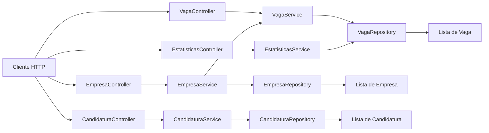

# Leque de Vagas

API REST em Spring Boot para consultar vagas, empresas, candidaturas e os números do catálogo. Nesta etapa os dados são mantidos em memória.

## Frentes da equipe

| Frente | Responsável | Escopo |
| --- | --- | --- |
| 1 — Vaga | Lívio Rocha | Cadastro e consulta de vagas |
| 2 — Empresa | Lívio Rocha | Empresas publicadoras de vagas |
| 3 — Pessoa e candidatura | Lívio Rocha | Pessoas e candidaturas |
| 4 — Busca e números | Lívio Rocha | Estatísticas do catálogo e revisão das entregas |

## Como executar

Requer Java 21 e Maven Wrapper.

```bash
sh mvnw spring-boot:run
```

A aplicação inicia em `http://localhost:8080`.

## Rotas disponíveis

| Método | Rota | Resposta |
| --- | --- | --- |
| `GET` | `/vagas` | Todas as vagas cadastradas |
| `GET` | `/vagas/{id}` | Uma vaga pelo identificador |
| `GET` | `/empresas` | Todas as empresas |
| `GET` | `/empresas/{slug}/vagas` | Vagas da empresa informada |
| `GET` | `/candidaturas` | Candidaturas cadastradas |
| `GET` | `/estatisticas` | Total de vagas, vagas para iniciantes e agrupamentos por área e senioridade |

Exemplo para consultar as estatísticas:

```bash
curl http://localhost:8080/estatisticas
```

## Como as classes se conectam

Cada rota começa em um controller. O controller recebe a requisição HTTP e chama o service correspondente. O service aplica a regra da funcionalidade e pede os dados ao repository. O repository guarda os objetos em memória nesta versão.



| Camada | Classes | Responsabilidade |
| --- | --- | --- |
| Controller | `VagaController`, `EmpresaController`, `CandidaturaController`, `EstatisticasController` | Define as rotas e devolve a resposta HTTP. Não contém regra de negócio. |
| Service | `VagaService`, `EmpresaService`, `CandidaturaService`, `EstatisticasService` | Centraliza a lógica de cada funcionalidade e chama os repositories necessários. |
| Repository | `VagaRepository`, `EmpresaRepository`, `CandidaturaRepository` | Mantém e consulta os dados em memória. |
| Model | `Vaga`, `Empresa`, `Pessoa`, `Candidatura`, `Estatisticas` | Representa os dados enviados e usados pela API. |

### Fluxo de estatísticas

`EstatisticasController` recebe `GET /estatisticas` e chama `EstatisticasService.calcular()`. O service consulta `VagaRepository` diretamente, conta as 12 vagas, filtra as que aceitam iniciantes e agrupa as vagas por `area` e `senioridade`. O resultado é devolvido como `Estatisticas` em JSON.

Essa dependência direta do `EstatisticasService` em `VagaRepository` é intencional: estatísticas são uma regra de negócio própria e não dependem de `VagaService`.

## Testes

```bash
sh mvnw test
```

`EstatisticasControllerTest` verifica o contrato HTTP de `GET /estatisticas` e os números derivados do catálogo em memória.
